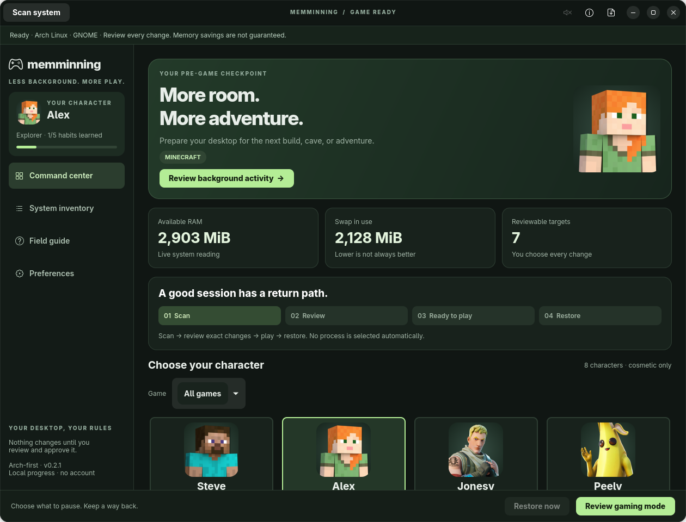

# Memminning

**Make room for play. Keep a way back.**

[](https://github.com/Shizzzzoo/memminning/actions/workflows/tests.yml)
[](https://github.com/Shizzzzoo/memminning/releases)
[](LICENSE)

Memminning is a native Linux desktop app that helps you review memory use and make **explicitly selected, temporary** changes before gaming. It combines a GTK 4 dashboard, an optional GNOME panel launcher, and an independent restoration timer.

**v1.0.0 is the first public preview.** Arch Linux with GNOME 51 on x86-64 is the tested target. Other desktop environments have partial discovery support; universal Linux compatibility and guaranteed memory/FPS improvements are not claimed.



## What it does

- Scans readable processes, loaded system/user services, and common desktop, browser and editor extension stores.
- Lets you review each enabled GNOME extension before temporarily disabling it.
- Offers temporary stops and soft memory limits for an allowlist of optional user services.
- Saves original state, arms a restoration timer, and supports **Restore now**, CLI recovery and login recovery.
- Keeps essential services and arbitrary process IDs outside its action allowlist.
- Provides private rotating logs and diagnostic exports that you review before sharing.
- Includes local milestones, session history, optional sounds, reduced motion and **Professional Mode**.
- Offers Steve, Alex, Jonesy, Peely, Jett, Sage, Phoenix and Reyna portraits through an optional artwork download, plus custom local avatars.

It does **not** kill arbitrary apps, flush caches, change swap, tune GPUs, modify Minecraft/JVM settings, bypass anti-cheat, or make unsupported games run on Linux. Installed extensions are not necessarily running. Shared process memory cannot be attributed accurately to individual plugins.

## Quick start — Arch Linux

Install the system dependencies as part of a normal full Arch update:

```bash
sudo pacman -Syu --needed git python python-gobject gtk4 libadwaita systemd

git clone --branch v1.0.0 https://github.com/Shizzzzoo/memminning.git
cd memminning
/usr/bin/python3 install.py --check
/usr/bin/python3 install.py --with-character-art
~/.local/bin/memminning
```

Run the installer **as your desktop user**, not with `sudo`. Use `/usr/bin/python3` so GTK bindings come from the distribution, even if Conda is active.

`--with-character-art` explicitly downloads the optional portraits from the sources listed in [artwork credits](assets/README.md), verifies their checksums, and caches them locally. Omit that option for an offline installation with generic icons and custom-image support. No network requests occur during ordinary character selection or gaming sessions.

The application appears as **Memminning** in your app menu. The optional GNOME panel launcher is installed but not automatically enabled: on GNOME 51, log out/in, then enable Memminning in **Extensions**.

[Detailed installation and updates →](docs/INSTALLATION.md)

## Your first session

1. Open **System inventory** and inspect **Reviewable targets**.
2. Choose a temporary action for each target you want to change. Everything starts at **Keep running**.
3. Set the restoration duration (1–480 minutes) and any soft memory limit.
4. Select **Review gaming mode**, read the exact targets and risks, and confirm.
5. Launch your game normally. You can close Memminning; its restoration timer runs separately.
6. Select **Restore now**, or wait for the timer. Check any reported recovery errors.

```bash
# Manual recovery
~/.local/bin/memminning --restore
```

A soft limit can increase swapping or latency. Stopping services interrupts their work; disabling extensions can change desktop controls. Read [safety and recovery](docs/SAFETY.md) before your first real session.

## Device and desktop support

| Environment | v1 status |
| --- | --- |
| Arch Linux, GNOME 51, Wayland, x86-64 PC/laptop | Tested development target; first public preview |
| Arch, KDE Plasma / Cinnamon / XFCE | Known plugin-store inventory; desktop-plugin changes unavailable; end-to-end use untested |
| Other Linux distributions with required GTK/systemd versions | Experimental; not yet validated |
| ARM64 devices / Raspberry Pi | Untested; no architecture-specific binary supplied |
| Steam Deck / SteamOS | Not validated or packaged; no Gaming Mode integration |
| Windows, macOS, Android, iOS, non-systemd Linux | Unsupported |

Requires Python **3.10+**, GTK **4.10+**, libadwaita **1.2+**, and systemd **254+**. A working user session bus is needed for actions; cgroup v2 memory-controller support is needed for soft limits. GNOME extension control needs `gnome-extensions` and a GNOME session. Only GNOME **51** is declared for the optional panel launcher.

[Full compatibility, hardware expectations and test boundaries →](docs/COMPATIBILITY.md)

## Documentation

| Guide | Contents |
| --- | --- |
| [Installation](docs/INSTALLATION.md) | Arch setup, dependencies, source archives, optional artwork, updates and uninstall |
| [Usage](docs/USAGE.md) | Inventory, gaming sessions, portraits, milestones, shortcuts and CLI |
| [Compatibility](docs/COMPATIBILITY.md) | Devices, distributions, desktops, discovery coverage and known limitations |
| [Safety and recovery](docs/SAFETY.md) | Action policy, timer behavior, conflicts, crashes and reboot recovery |
| [Troubleshooting](docs/TROUBLESHOOTING.md) | GTK/session errors, missing portraits, timer failures and diagnostic collection |
| [Development](docs/DEVELOPMENT.md) | Project structure, tests, CI and release procedure |
| [Support](SUPPORT.md) | Questions, bug reports and feature requests |

## Support and contributing

[Report a bug](https://github.com/Shizzzzoo/memminning/issues/new?template=bug_report.yml) · [Request a feature](https://github.com/Shizzzzoo/memminning/issues/new?template=feature_request.yml) · [Release downloads](https://github.com/Shizzzzoo/memminning/releases)

Support is community-based, with no guaranteed response time. Include your desktop, distribution, versions and reproduction steps. Review diagnostics before posting: error text can contain identifiers or paths. See [CONTRIBUTING.md](CONTRIBUTING.md) and [SECURITY.md](SECURITY.md).

## License and character artwork

Memminning's original code and documentation are licensed under [MIT](LICENSE). Third-party character artwork, trademarks and other publisher-owned material are **not** covered by that license. Full character image files are excluded from the Git repository and release archives; the optional installer downloads them from documented sources. Screenshots illustrate the application with optional artwork enabled.

See [THIRD_PARTY_NOTICES.md](THIRD_PARTY_NOTICES.md) and [artwork sources](assets/README.md). Memminning is not affiliated with Mojang, Microsoft, Nintendo, Epic Games or Riot Games.
